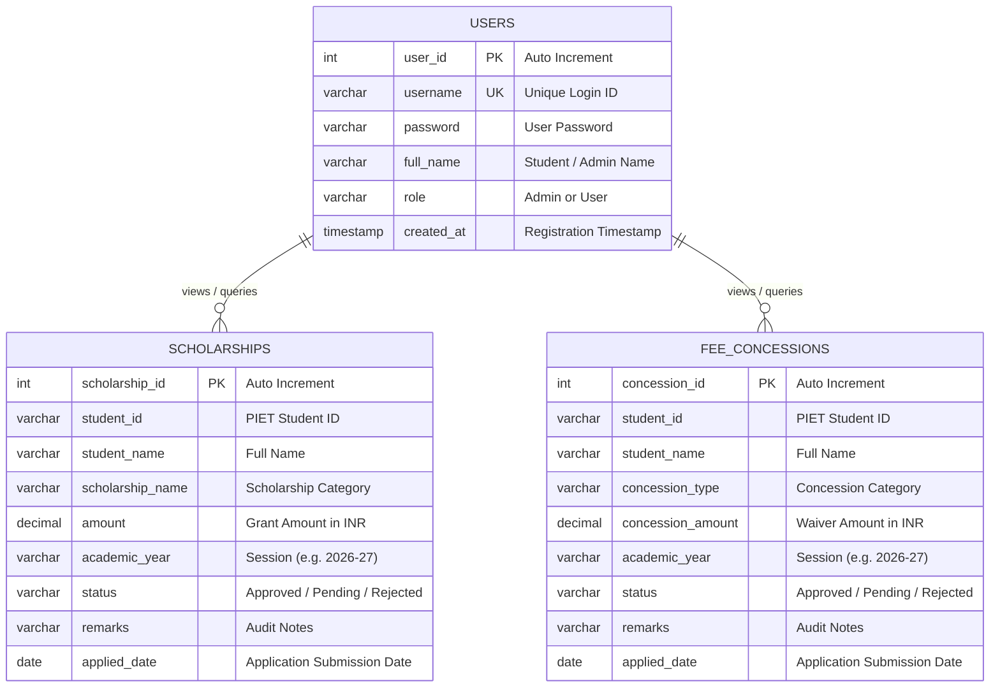

# Database Design & Schema Documentation
## Student Scholarship & Fee Concession System

**Candidate:** AYUSH SINGH (PIET25CR009)  
**Institution:** Poornima Institute of Engineering & Technology (PIET)  
**Session:** 2026–27 | Section: 3CSD  
**Database Engine:** MySQL Server 8.4  
**Database Name:** `scholarship_fee_db`  

---

## 1. Database Overview & Normalization
The database `scholarship_fee_db` is designed following relational database normalization principles up to **Third Normal Form (3NF)**:
- **First Normal Form (1NF):** All attributes are atomic. No multi-valued attributes or repeating groups exist.
- **Second Normal Form (2NF):** Every table has a dedicated primary key (`user_id`, `scholarship_id`, `concession_id`), and all non-key attributes are fully functionally dependent on the entire primary key.
- **Third Normal Form (3NF):** No transitive dependencies exist between non-key attributes; all fields directly describe the entity represented by the primary key.

---

## 2. Entity-Relationship (ER) Architecture



---

## 3. Data Dictionaries

### Table 1: `users`
Stores user credentials and role classification for system access.

| Column Name | Data Type | Constraint | Description |
| :--- | :--- | :--- | :--- |
| `user_id` | `INT` | `PRIMARY KEY, AUTO_INCREMENT` | Unique identifier for system user |
| `username` | `VARCHAR(50)` | `NOT NULL, UNIQUE` | Login username (e.g., `admin`, `user1`) |
| `password` | `VARCHAR(100)` | `NOT NULL` | Account password |
| `full_name` | `VARCHAR(100)` | `NOT NULL` | Display name of user |
| `role` | `VARCHAR(20)` | `NOT NULL, DEFAULT 'User'` | Authorization role: `'Admin'` or `'User'` |
| `created_at` | `TIMESTAMP` | `DEFAULT CURRENT_TIMESTAMP` | Account creation timestamp |

### Table 2: `scholarships`
Stores student scholarship applications, category details, amounts, and approval states.

| Column Name | Data Type | Constraint | Description |
| :--- | :--- | :--- | :--- |
| `scholarship_id` | `INT` | `PRIMARY KEY, AUTO_INCREMENT` | Unique scholarship record number |
| `student_id` | `VARCHAR(30)` | `NOT NULL` | Institutional Student ID (e.g., `PIET25CR015`) |
| `student_name` | `VARCHAR(100)` | `NOT NULL` | Full name of student |
| `scholarship_name` | `VARCHAR(100)` | `NOT NULL` | Type (Merit, STEM, Sports, Need-Based) |
| `amount` | `DECIMAL(10,2)` | `NOT NULL` | Sanctioned scholarship grant in ₹ |
| `academic_year` | `VARCHAR(20)` | `NOT NULL` | Academic year (e.g., `2026-27`) |
| `status` | `VARCHAR(20)` | `NOT NULL, DEFAULT 'Pending'`| Approval status (`Approved`/`Pending`/`Rejected`)|
| `remarks` | `VARCHAR(255)` | `NULL` | Committee evaluation notes |
| `applied_date` | `DATE` | `NOT NULL` | Date when application was submitted |

### Table 3: `fee_concessions`
Stores fee waiver records, concession types, amounts, and approval states.

| Column Name | Data Type | Constraint | Description |
| :--- | :--- | :--- | :--- |
| `concession_id` | `INT` | `PRIMARY KEY, AUTO_INCREMENT` | Unique fee concession record number |
| `student_id` | `VARCHAR(30)` | `NOT NULL` | Institutional Student ID (e.g., `PIET25CR015`) |
| `student_name` | `VARCHAR(100)` | `NOT NULL` | Full name of student |
| `concession_type` | `VARCHAR(100)` | `NOT NULL` | Waiver type (Sibling, EWS, Staff Ward, Merit) |
| `concession_amount`| `DECIMAL(10,2)` | `NOT NULL` | Fee concession amount in ₹ |
| `academic_year` | `VARCHAR(20)` | `NOT NULL` | Academic year (e.g., `2026-27`) |
| `status` | `VARCHAR(20)` | `NOT NULL, DEFAULT 'Pending'`| Approval status (`Approved`/`Pending`/`Rejected`)|
| `remarks` | `VARCHAR(255)` | `NULL` | Verification notes |
| `applied_date` | `DATE` | `NOT NULL` | Submission date |

---

## 4. Sample Seed Data
The database is pre-seeded with realistic sample records in `sql/schema.sql`:

### 4.1 System Accounts
- **Admin:** `admin` / `admin123` (Name: *Ayush Singh (Admin)*)
- **Student 1:** `user1` / `user123` (Name: *Rahul Sharma*)
- **Student 2:** `user2` / `user123` (Name: *Priya Verma*)
- **Student 3:** `user3` / `user123` (Name: *Amit Kumar*)

### 4.2 Seed Scholarship Applications
- `PIET25CR015` (Rahul Sharma): Merit Scholarship (₹ 25,000.00) - Approved
- `PIET25CR022` (Priya Verma): Girl Child STEM Grant (₹ 20,000.00) - Approved
- `PIET25CR034` (Amit Kumar): Need-Based Financial Aid (₹ 18,000.00) - Pending
- `PIET25CR041` (Sneha Patel): Sports Excellence Award (₹ 15,000.00) - Approved
- `PIET25CR058` (Vikas Meena): PIET Star Scholar Scheme (₹ 30,000.00) - Pending
- `PIET25CR073` (Neha Choudhary): Need-Based Financial Aid (₹ 15,000.00) - Rejected

### 4.3 Seed Fee Concessions
- `PIET25CR015` (Rahul Sharma): Sibling Concession (₹ 10,000.00) - Approved
- `PIET25CR022` (Priya Verma): EWS Category Waiver (₹ 15,000.00) - Approved
- `PIET25CR034` (Amit Kumar): Staff Ward Concession (₹ 12,000.00) - Pending
- `PIET25CR062` (Rohan Gupta): Merit Fee Waiver (₹ 10,000.00) - Approved
- `PIET25CR088` (Ananya Joshi): Special Discretionary Waiver (₹ 8,000.00) - Rejected

---

## 5. SQL Script Execution Verification
The SQL script can be cleanly imported into MySQL Workbench or via MySQL CLI:
```bash
mysql -u root -p < sql/schema.sql
```
Execution results verified: 3 tables created, 4 users inserted, 6 scholarship records seeded, 5 concession records seeded.
