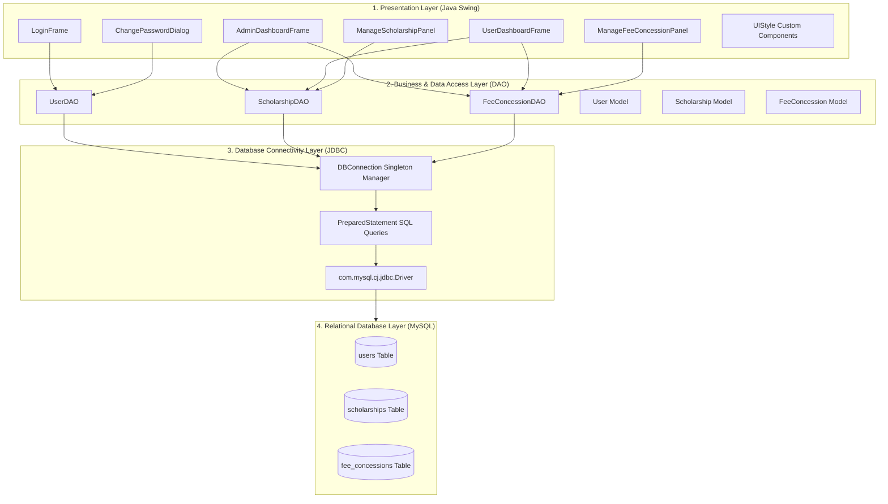
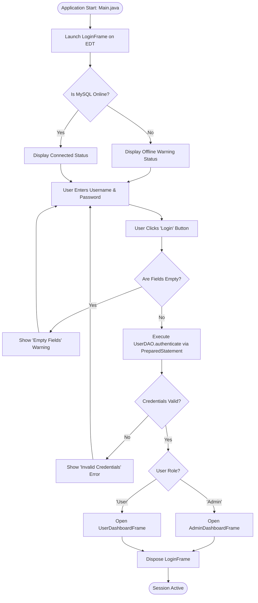
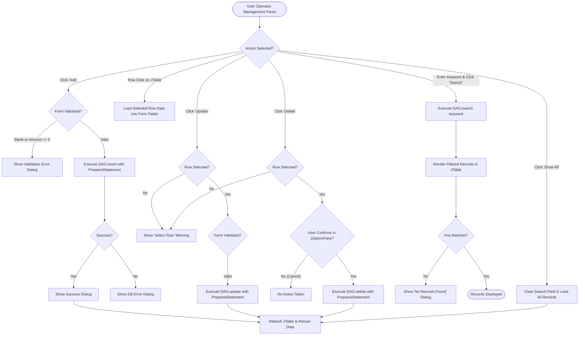
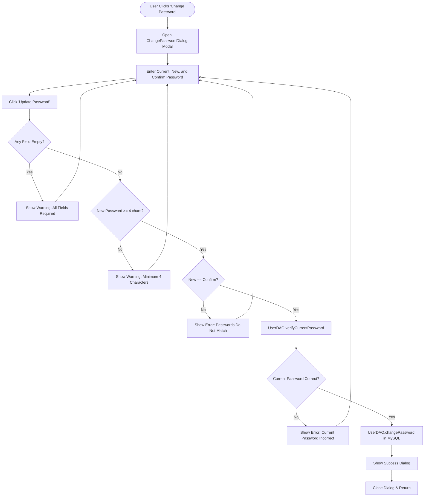
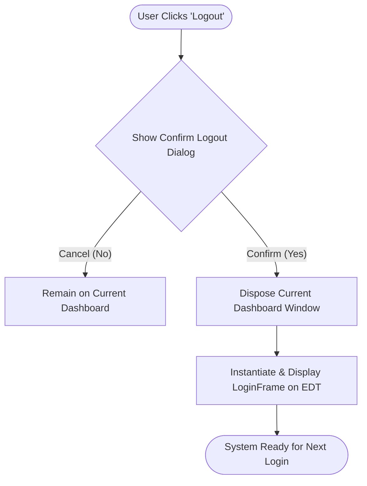

# System Architecture & Flowcharts
## Student Scholarship & Fee Concession System

**Author:** AYUSH SINGH (PIET25CR009)  
**Department:** Computer Science & Engineering, 3CSD  
**Institution:** Poornima Institute of Engineering & Technology (PIET)  
**Session:** 2026–27  

---

## 1. Multi-Tier Layered Architecture

The application adopts a clean, modular 3-tier desktop architecture:

---

## 2. Process Flowcharts

### 2.1 Login & Role-Based Routing Flowchart

---

### 2.2 Record CRUD & Search Flowchart (Scholarship / Concession)

---

### 2.3 Password Change Flowchart

---

### 2.4 Logout Flowchart

